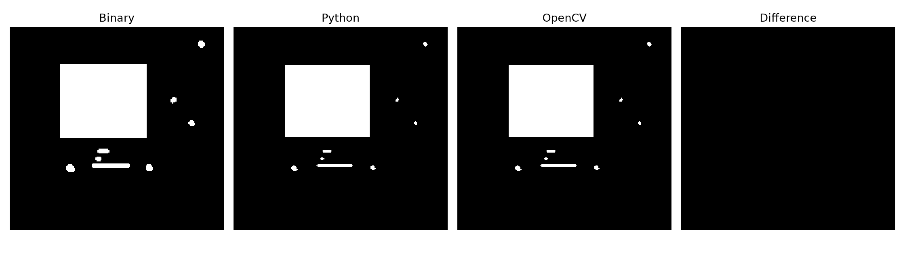
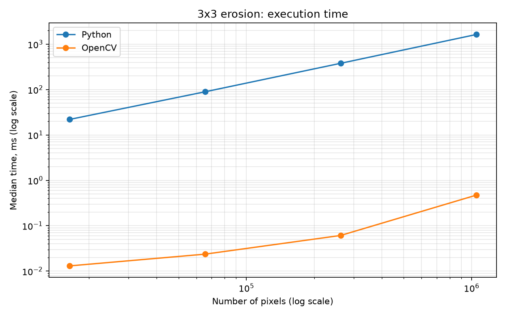

# Эрозия изображения примитивом 3×3

## 1. Теоретическая база

**Эрозия** убирает пиксели по краям белых объектов на чёрном фоне. Линии становятся тоньше, а мелкие детали могут исчезнуть. Масштаб всей картинки при этом не меняется.

**Примитив 3×3** — квадратное окно из центрального пикселя и восьми соседних. Центральный пиксель остаётся белым, только если все девять пикселей белые. Иначе он становится чёрным. Например, белый квадрат 3×3 на чёрном фоне превращается в одну точку.

Это соответствует поиску минимальной яркости в окне:

$$
E(y,x)=\min_{i,j\in\{-1,0,1\}} I(y+i,x+j).
$$

Здесь `I` — исходное изображение, `E` — результат. Чёрный пиксель имеет значение 0, белый — 255.

## 2. Разработанная система

Весь код находится в [main.py](main.py). Ниже приведены основные части программы.

### `erode_opencv`: библиотечная обработка

Функция выполняет эрозию через OpenCV. Используется квадратное ядро 3×3, один проход и чёрный фон за границами изображения.

```python
KERNEL = np.ones((3, 3), dtype=np.uint8)


def erode_opencv(image):
    return cv2.erode(
        image,
        KERNEL,
        iterations=1,
        borderType=cv2.BORDER_CONSTANT,
        borderValue=0,
    )
```

### `erode_python`: ручная обработка

Изображение преобразуется в список строк и дополняется чёрной рамкой толщиной один пиксель. Рамка позволяет обрабатывать края по тому же правилу, что и середину картинки.

```python
height, width = image.shape
rows = image.tolist()

padded = [[0] * (width + 2)]
padded += [[0] + row + [0] for row in rows]
padded += [[0] * (width + 2)]
```

Для каждого пикселя циклы находят минимум в окне 3×3. Если в окне есть чёрный пиксель, минимум равен 0. Результат записывается отдельно, исходное изображение не изменяется.

```python
result = [[0] * width for _ in range(height)]

for y in range(height):
    for x in range(width):
        minimum = 255

        for dy in range(3):
            for dx in range(3):
                value = padded[y + dy][x + dx]
                if value < minimum:
                    minimum = value

        result[y][x] = minimum
```

NumPy используется только для преобразования входа и выхода. Сам поиск минимума выполняется обычными циклами и сравнениями Python. Сложность по времени и дополнительной памяти — O(HW), где H и W — размеры изображения.

### `check_result` и `run_tests`: проверка корректности

`check_result` сравнивает результаты обеих реализаций с ожидаемым изображением. При несовпадении возникает ошибка.

```python
for function in (erode_python, erode_opencv):
    actual = function(image)

    if not np.array_equal(actual, expected):
        raise AssertionError(
            f"Неверный результат: {function.__name__}"
        )
```

`run_tests` запускает девять контрольных случаев и полный перебор 512 бинарных окон 3×3.

### `benchmark`: сравнение скорости

Функция создаёт изображения разных размеров и измеряет время обработки. Сначала выполняется предварительный запуск, затем пять серий измерений.

```python
function(image)  # Прогрев вне измерения.

samples = timeit.repeat(
    lambda: function(image),
    repeat=5,
    number=calls,
)

samples = [seconds * 1000 / calls for seconds in samples]
measured.append(median(samples))
```

Для Python `calls = 1`, для OpenCV `calls = 1000`. Время серии делится на число вызовов: сравнивается время одной обработки. Результаты сохраняются в `timings.csv` и `benchmark.png`.

### `main`: порядок работы

`main` запускает тесты, загружает изображение и выполняет бинаризацию. Затем вызывает обе реализации эрозии и сохраняет сравнение.

```python
_, binary = cv2.threshold(original, 127, 255, mode)

native = erode_python(binary)
library = erode_opencv(binary)

check_result(binary, library)

mismatches = save_comparison(
    original, binary, native, library, folder
)

benchmark(folder)
```

Установка зависимостей и запуск:

```bash
python -m pip install numpy opencv-python-headless matplotlib
python -u main.py --input shapes.png
```

Для чёрных объектов на белом фоне добавляется `--invert`. Без `--input` используется встроенная картинка. Повторный запуск перезаписывает файлы результатов в папке `results`.

## 3. Результаты работы и тестирования

### Обработка изображения

Использовано изображение [shapes.png](shapes.png) с белым прямоугольником, пятнами и линиями на чёрном фоне.



Слева направо: бинарное изображение, результат Python, результат OpenCV и карта различий.

После обработки прямоугольник немного уменьшился, пятна стали меньше, а линии — тоньше. Результаты обеих реализаций совпадают: карта различий полностью чёрная. Программа дополнительно проверяет совпадение массивов пикселей.

### Быстродействие

Измеряется время одной обработки. Для этого программа отдельно создаёт случайные бинарные картинки размером 128×128, 256×256, 512×512 и 1024×1024. Это наборы случайно расположенных белых и чёрных пикселей; обе реализации получают одну и ту же картинку.

Проводятся **пять серий**. В каждой серии Python вызывается один раз, OpenCV — 1000 раз, поскольку его отдельный вызов очень короткий. Общее время серии делится на число вызовов. Например, если 1000 обработок заняли 20 мс, время одной обработки составляет 0,02 мс.

На графике показана **медиана** пяти значений: среднее по положению число после сортировки. Она меньше зависит от одного случайного скачка времени.



По горизонтали — число пикселей, по вертикали — время в миллисекундах. Обе шкалы логарифмические. OpenCV работает заметно быстрее; время нативной версии растёт примерно пропорционально числу пикселей.

Все измерения: [timings.csv](results/timings.csv).

## 4. Выводы

Обе реализации выполняют эрозию 3×3 и дают одинаковый результат. Операция уменьшает толщину линий и размеры белых областей. OpenCV быстрее благодаря скомпилированному коду, а нативная версия позволяет проследить алгоритм по каждому пикселю.

## 5. Использованные источники

1. [OpenCV: морфологические операции](https://docs.opencv.org/4.x/d9/d61/tutorial_py_morphological_ops.html).
2. [Python: измерение времени с timeit](https://docs.python.org/3/library/timeit.html).
