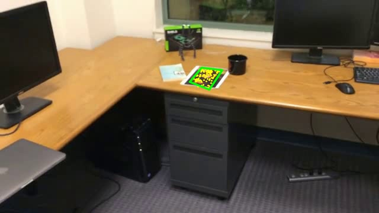
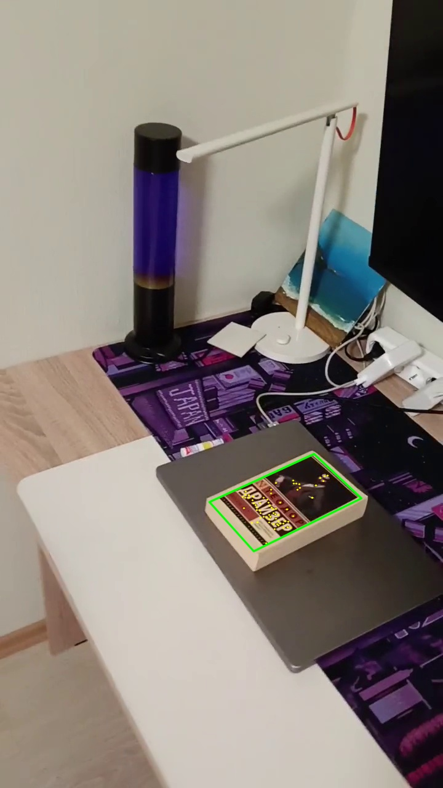

# Лабораторная работа № 2. Трекинг объекта по ключевым точкам

Программа на Python находит плоский текстурный объект из первого кадра на
последующих кадрах. Для обнаружения объекта используется алгоритм
**SIFT (Scale-Invariant Feature Transform)**.
Результат — видео с зелёной четырёхугольной рамкой
и жёлтыми отслеживаемыми точками внутри объекта.

## 1. Теоретическая база

Программа ищет на видео плоский объект с большим количеством деталей: картинку, обложку, открытку, распечатанный текст. Первый кадр считается эталоном: на нём объект виден крупно, и программа запоминает его характерные детали.

Ключевая точка - это заметная деталь изображения: угол, пятно, окончание линии, участок текстуры. В работе используется алгоритм SIFT. Он находит такие точки в разных масштабах и для каждой точки строит дескриптор — набор чисел, который кратко описывает, как выглядит окрестность этой точки. По дескрипторам можно сравнивать детали между кадрами: похожие детали дают похожие наборы чисел. SIFT неплохо узнаёт точку при повороте и изменении размера, но сильное размытие, блики и сильный наклон могут мешать.

Чтобы найти объект на новом кадре, программа сравнивает дескрипторы эталона с дескрипторами кадра. Для каждой точки эталона ищутся два самых похожих варианта на кадре. Пара принимается, только если лучший вариант заметно лучше второго. Это отсеивает неоднозначные совпадения, когда непонятно, какой из двух участков действительно соответствует точке.

Для плоского объекта положение эталона на кадре описывается гомографией — преобразованием, которое переводит координаты объекта на эталоне в координаты на текущем кадре. Простыми словами, гомография может повернуть, наклонить и растянуть прямоугольник так, как объект выглядит в кадре. Алгоритм MAGSAC оценивает это преобразование и отбрасывает ошибочные пары точек. Пары, которые согласуются с общим преобразованием, называются инлаерами. Если преобразовать четыре угла эталона, получится рамка вокруг объекта с учётом перспективы.

При сильном отдалении мелкие детали исчезают, и одного SIFT может не хватить. Поэтому дополнительно используется оптический поток Lucas–Kanade. Он отслеживает, куда переместились маленькие участки вокруг уже найденных точек из предыдущего кадра в текущий. Чтобы не ошибаться, выполняется проверка "вперёд–назад": точка переносится в текущий кадр, а потом обратно. Если она вернулась примерно туда же, ей можно доверять. Так программа может удерживать рамку между повторными поисками SIFT.

Итого цепочка простая: SIFT находит и описывает детали → похожие детали сопоставляются → по ним оценивается положение плоскости → рамка рисуется по четырём углам → оптический поток помогает удержать объект между повторными обнаружениями.

## 2. Описание разработанной системы

Архитектура
Вся программа находится в main.py, зависимости — в requirements.txt.

main() — разбирает аргументы командной строки: видео или папка, --output, --roi, --label.

track() — читает видео, создаёт трекер, обрабатывает кадры и сохраняет результат: AVI, CSV, JSON и контрольные JPG.

PlanarTracker — хранит эталон, его дескрипторы и текущее положение объекта. Основные методы:

detect() — поиск объекта по SIFT;

flow() — сопровождение оптическим потоком;

estimate() — проверка геометрии и оценка гомографии;

seed_points() — добавление новых точек внутри рамки;

update() — логика обработки одного кадра.

## 3. Результаты работы и тестирования системы

Работа системы проверена на двух видео: тестовом ролике с изображением
Моны Лизы и собственном видео с обложкой книги Теодора Драйзера «Финансист».
Результаты обработки сохранены в папке `result`.

| Результат обработки | Размер кадра | Кадров с рамкой / всего | Доля кадров с рамкой |
| --- | --- | ---: | ---: |
| [mona-lisa_tracked.avi](result/mona-lisa_tracked.avi) | 640×360 | 558 / 558 | 100% |
| [my_test_video_tracked.avi](result/my_test_video_tracked.avi) | 720×1280 | 405 / 405 | 100% |

В видео с Моной Лизой рамка сохраняется при отдалении камеры, когда изображение
картины становится маленьким. На контрольных кадрах рамка следует за картиной,
а жёлтые точки располагаются на её деталях.

В собственном видео отслеживается обложка книги. При отдалении камеры и
изменении угла съёмки рамка уменьшается и меняет перспективу вместе с обложкой.
Точки остаются на изображении и надписях обложки. По сохранённой статистике
рамка присутствует на всех 405 кадрах собственного видео.

## 4. Выводы по работе

SIFT, сопоставление дескрипторов, MAGSAC и оптический поток позволяют построить трекер
плоского объекта без обучения нейросети. Гомография учитывает перспективу,
поэтому рамка может точнее описывать наклонённый объект, чем обычный прямоугольник.
Алгоритм зависит от качества эталона и количества видимых деталей. Сильное
размытие, перекрытие, блики, малый размер и деформация объекта могут приводить
к пропускам или ошибочным рамкам. На кадрах без надёжной оценки рамка не рисуется.

## 5. Использованные источники

- [OpenCV: Feature Matching + Homography to find Objects](https://docs.opencv.org/4.x/d1/de0/tutorial_py_feature_homography.html).
- [OpenCV: Feature Matching with FLANN](https://docs.opencv.org/4.x/d5/d6f/tutorial_feature_flann_matcher.html).
- [OpenCV: Basic concepts of the homography](https://github.com/opencv/opencv/blob/4.x/doc/tutorials/features2d/homography/homography.markdown).
- [OpenCV: Optical Flow](https://docs.opencv.org/4.x/d4/dee/tutorial_optical_flow.html).
- Условие работы — `task.txt`, тестовые ролики — папка `videos/`.
